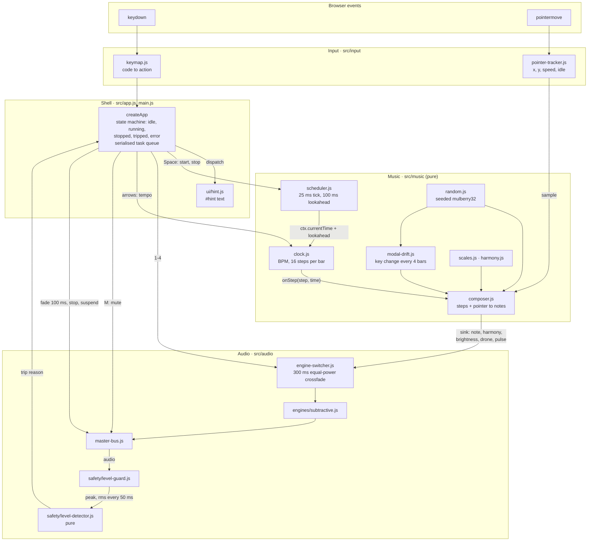
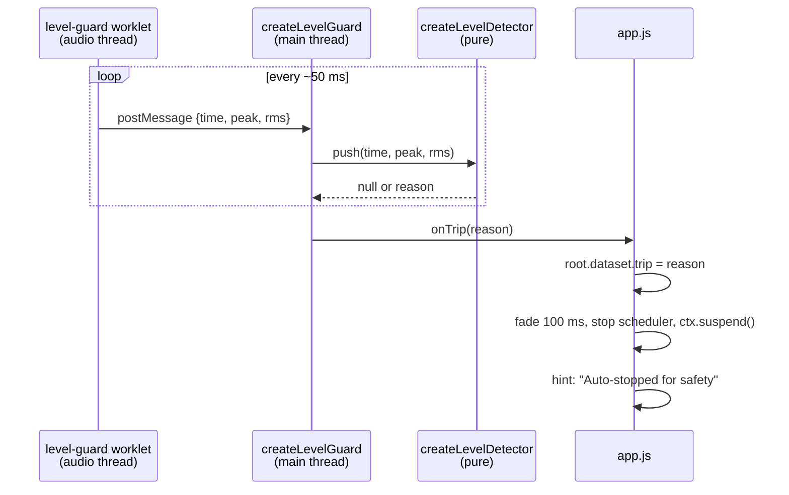

# magik-muzak Architecture

Current implementation, as of delivery increment 1 ([spec](spec.md)): the subtractive engine
working end to end, both guardrails in place, no canvas yet.

## System diagram

Control flow — DOM events through state into scheduled sound.

The composer never touches Web Audio directly. It calls a `sink` object that `app.js` forwards to
whichever engine is active, which is what makes `src/music` unit-testable without an `AudioContext`.

Timers only decide *when to schedule*. Every sound event is placed on the audio clock via
`AudioParam` automation at an explicit `time`, so `setTimeout` jitter never reaches the output.

## Signal flow diagram

Every box is a live `AudioNode`. Nodes are created once and reused; notes only automate params.

```mermaid
flowchart LR
  subgraph engine["Subtractive engine — per voice: 2 detuned saws"]
    direction TB
    MV["11 melody voices<br/>saw x2 to lowpass 1200 Hz<br/>to amp to panner"]
    PV["5 pad voices<br/>saw x2 to lowpass 600 Hz<br/>to amp to panner"]
    MBUS["melodyBus"]
    PBUS["padBus 0.5"]
    PULSE["pulseGain<br/>rhythmic ducking"]
    MV --> MBUS
    PV --> PBUS --> PULSE
  end

  FADE["engine fade gain<br/>equal-power crossfade"]
  IN["master input"]
  PAN["StereoPanner"]
  LFO["Osc 0.05 Hz"]
  DEPTH["gain 0.25"]

  DRY["dry 0.8"]
  DS["delaySend 0.22"]
  DLY["Delay<br/>dotted 8th of tempo"]
  TONE["lowpass 2200 Hz"]
  FB["feedback 0.35"]
  RS["reverbSend 0.35"]
  REV["Convolver<br/>generated IR, 3 s"]

  LIM["DynamicsCompressor limiter<br/>-18 dB, ratio 12"]
  MUTE["muteGain<br/>M key"]
  MASTER["masterGain<br/>ceiling 0.5"]
  GUARDN["level-guard AudioWorklet<br/>pass-through meter"]
  ANA["Analyser 2048<br/>unused until phase 3"]
  DEST["destination"]

  MBUS --> FADE
  PULSE --> FADE
  FADE --> IN --> PAN
  LFO --> DEPTH --> PAN

  PAN --> DRY --> LIM
  PAN --> DS --> DLY --> TONE --> LIM
  TONE --> FB --> DLY
  PAN --> RS --> REV --> LIM

  LIM --> MUTE --> MASTER --> GUARDN --> ANA --> DEST
```

Note the ordering of the last stage: **mute and master gain sit before the guard**, so the guard
measures exactly what reaches the speakers — a muted or faded-out signal reads as quiet, and the
0.5 ceiling is inside the measured path.

## Safety chain

Measurement runs on the audio thread so it keeps working when animation frames are throttled — a
backgrounded tab still gets metered. The detector itself is pure and synchronous, which is why it
can be unit-tested against synthetic level traces.

Four trip reasons, all thresholds in `src/audio/safety/safety-config.js`:

| Reason | Condition |
|---|---|
| `peak` | Sample peak above 0.95, or NaN |
| `jump` | RMS up 12 dB or more within 200 ms, above a -16 dBFS floor |
| `sustained` | RMS above -10 dBFS for more than 300 ms |
| `creep` | RMS mean rising across all 5 bins of a 5 s window, ending above -16 dBFS |

## State

`app.js` holds all mutable state; everything under `src/music` and `src/input` is a pure factory.

- **States:** `idle` → `running` ⇄ `stopped`, plus terminal-ish `tripped` and `error`. Mirrored to
  `document.body.dataset.state`, which is what the E2E tests assert on.
- **Serialised queue:** `enqueue` chains async transitions onto one promise, so a fast
  Space-Space-Space can't interleave `ctx.resume()` with a fade-out.
- **Lazy `AudioContext`:** constructed inside the first `toggle`, satisfying Chrome's autoplay
  policy. `initAudio` also awaits `audioWorklet.addModule` before anything can make sound.
- **Crossfade interlock:** `engine-switcher.js` refuses a switch while `busyUntil` is in the
  future, because overlapping `setValueCurveAtTime` calls on one param throw.

## Not yet built

Engines 2–4 (`ENGINES` holds only `1`), the reactive canvas, and `prefers-reduced-motion`
handling. The `analyser` node is wired and ready for the canvas but nothing reads from it today.
